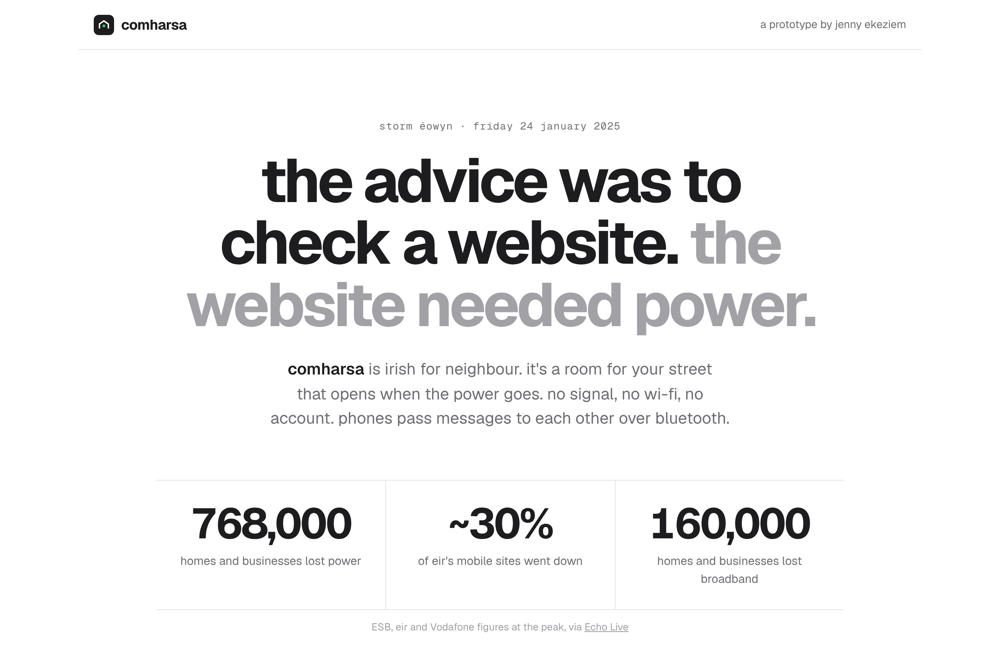
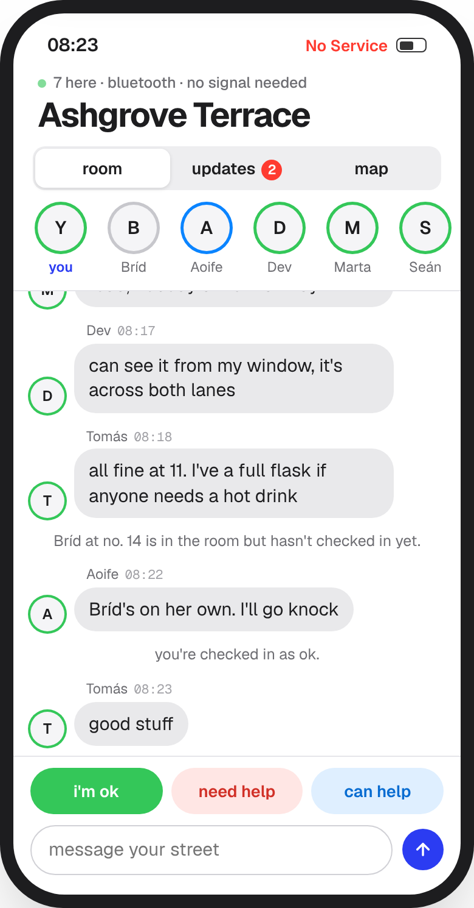
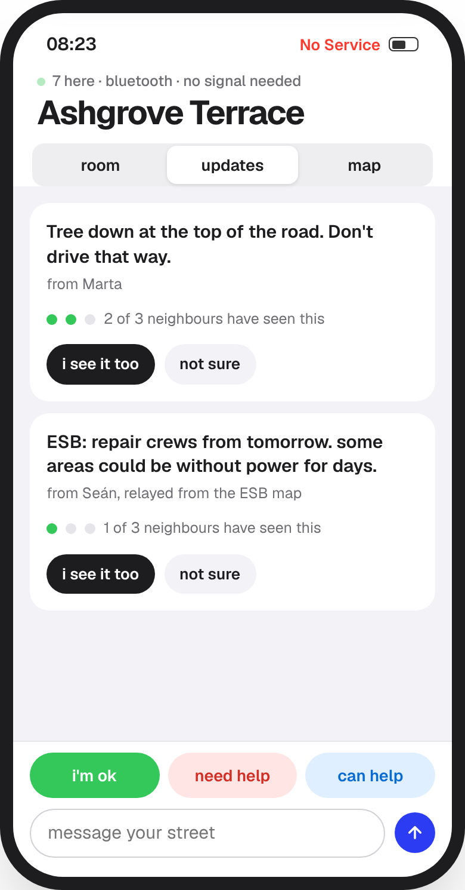
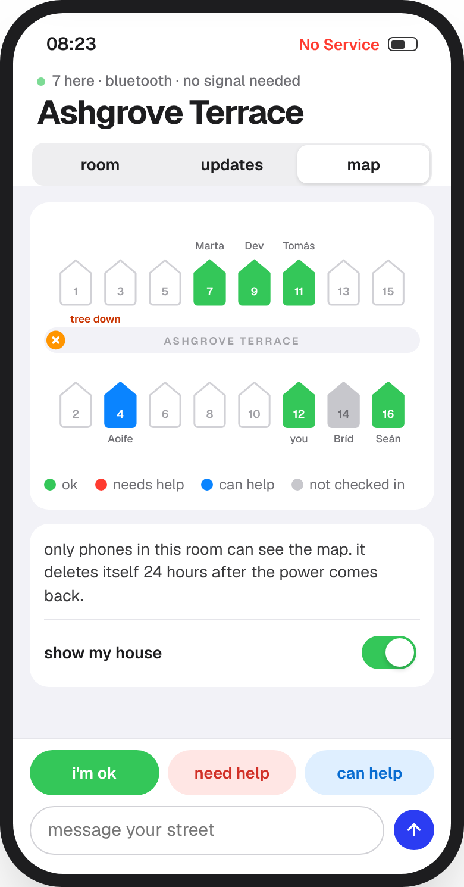

# comharsa

**a room for your street that opens when the power goes.**

*comharsa is irish for neighbour.*

an initiative for [**AIMSIR**](https://www.ucd.ie/aimsir/about), in association with **University College Dublin**

[**try the prototype →**](https://jekeziem.github.io/comharsa/)

## the problem

On Friday 24 January 2025, Storm Éowyn hit Ireland.

| | |
|---|---|
| **768,000** | homes and businesses lost power at the peak |
| **~30%** | of eir's mobile sites went down |
| **160,000** | homes and businesses lost broadband |

The official advice was to check ESB's online outage map. With no power and no signal, you can't.

So people did what people do: they knocked on doors. Comharsa is built for that knock.

## what it does

When the power and network drop, the phones on a street find each other over Bluetooth and form a room. Messages hop from phone to phone, house to house. No signal, no Wi-Fi, no account, nothing to download mid-storm.

<table>
<tr>
<td width="33%"></td>
<td width="33%"></td>
<td width="33%"></td>
</tr>
<tr>
<td><b>the room</b> everyone on the street, ringed by how they are: ok, need help, can help, or not heard from yet.</td>
<td><b>updates</b> "tree down at the top of the road" only counts as confirmed once three neighbours have seen it.</td>
<td><b>the map</b> who's checked in, house by house. only the room can see it, and it deletes itself.</td>
</tr>
</table>

## why it works like this

Every part of the design comes from how people actually behave in an emergency. The longer version is in [design notes](docs/design-notes.md).

- **the room finds you.** Nobody remembers to download an app during a storm, so the room forms on its own when the network goes.
- **built for checking with each other.** When people get a warning, they don't act straight away. They check with others first (disaster researchers call it *milling*). So updates show how many neighbours have seen them.
- **"someone else will check on her."** The more people who could help, the less each one feels it's on them: the bystander effect (Latané & Darley). Check-ins say out loud who hasn't been heard from.
- **safety first.** A map of who's home in a storm is also a map of who's alone. So only the room sees it, anyone can hide their house, and it's gone 24 hours after the lights come back.

## try it

Open the [live prototype](https://jekeziem.github.io/comharsa/), press **cut the power**, join your street's room, check in, and confirm an update. The neighbours are simulated and follow a short script.

To run it locally, download `index.html` and open it in a browser. It's one file with no build step.

## how it's built

| | |
|---|---|
| prototype | one HTML file: HTML, CSS and vanilla JavaScript, no frameworks |
| type | [Geist](https://vercel.com/font) and Geist Mono |
| designed to run on | [bitchat](https://github.com/permissionlesstech/bitchat)'s open-source Bluetooth mesh (public domain) |

## what's next

- [ ] **a mesh simulator in Python.** If 30% of the phones on a street die, does a message still reach no. 14? How many phones does a street need before the room works at all?
- [ ] **getting it onto phones before the storm.** The people who'd need it most are the least likely to install a new app. The answer probably runs through councils, ESB, or community alert groups, not app stores.
- [ ] **a real app** in React Native and Expo, talking to the same Bluetooth mesh.

## about this initiative

Comharsa is an initiative undertaken for [AIMSIR](https://www.ucd.ie/aimsir/about), the Centre for AI, Meteorological Services, Innovation and Research, in association with University College Dublin. AIMSIR works on AI for weather, flood and climate services in Ireland. Comharsa looks at the other end of the forecast: what happens on a street once the warning comes true and the power goes.

## credits

Storm figures: ESB, eir and Vodafone at the peak, reported by [Echo Live](https://www.echolive.ie/nationalnews/arid-41560450.html). Mesh networking approach: [bitchat](https://github.com/permissionlesstech/bitchat). The street, neighbours and messages in the demo are fictional.

 

made in dublin by **jenny ekeziem** · [portfolio](https://jekeziem.github.io)

when something goes wrong, people don't need a smarter system. they need to know the people next door are ok.

